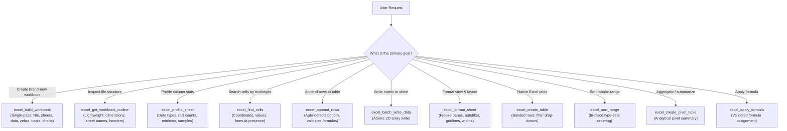

# Excel Tools Reference & Decision Matrix

This skill is the authoritative developer and agent encyclopedia for the **excel-mcp** server (`luiccian-excel-mcp`). It provides a tool selection decision tree, argument specifications, formatting tokens, and error handling protocols.

---

## 1. Tool Selection Decision Matrix

### Token Cost Comparison

| Operation | Legacy Granular Approach | Optimized Approach | Savings |
| :--- | :--- | :--- | :--- |
| **New 2-Sheet Financial Model** | `create_workbook` + 80 `write_data` + 30 `format_range` (111 calls, ~45,000 tokens) | `excel_build_workbook` (1 call, ~1,800 tokens) | **>95%** |
| **Workbook Inspection** | `read_data` dumping 5,000 rows (~30,000 tokens) | `excel_get_workbook_outline` (1 call, ~250 tokens) | **>98%** |
| **Worksheet Profiling** | Reading all cells into context (~20,000 tokens) | `excel_profile_sheet` (1 call, ~300 tokens) | **>98%** |
| **Appending 20 Data Rows** | 20 individual `write_data` calls (~6,000 tokens) | `excel_append_rows` (1 call, ~500 tokens) | **>90%** |
| **Finding Cell Coordinates** | Dumping full sheet matrix (~15,000 tokens) | `excel_find_cells` (1 call, ~200 tokens) | **>98%** |

---

## 2. Complete Canonical Tool Inventory (33 Tools)

### A. Batch & Single-Pass Tools (Priority 1)

1. **`excel_build_workbook`**
   - **Access Mode:** Write
   - **Purpose:** Construct complete, publication-ready workbooks with multiple sheets in a single atomic pass.
   - **Arguments:** `filename`, `sheets` (list of sheet dicts with `name`, `title`, `headers`, `rows`, `auto_totals`, `currency_columns`, `chart`, `freeze_panes`, `auto_filter`), `preset` (`"corporate"`, `"financial"`, `"modern"`, `"compact"`), `auto_fit` (`bool`), `font_name` (*optional*, e.g. `"Calibri"`, `"Arial"`), `font_size` (*optional*, e.g. `11`).

2. **`excel_get_workbook_outline`**
   - **Access Mode:** Read-Only
   - **Purpose:** Extract structure, dimensions, sheets, column headers, and formula presence without loading cell matrices into context.
   - **Arguments:** `filename`.

3. **`excel_batch_write_data`**
   - **Access Mode:** Write
   - **Purpose:** Write a 2D matrix of values or formulas atomically into an existing worksheet.
   - **Arguments:** `filename`, `sheet_name`, `data_matrix`, `start_cell` (`"A1"`).

4. **`excel_append_rows`**
   - **Access Mode:** Write
   - **Purpose:** Append batch rows below existing data automatically detecting the next available row.
   - **Arguments:** `filename`, `rows`, `sheet_name` (*optional*), `start_column` (`1`).

---

### B. Search & Analytical Profiling Tools

5. **`excel_find_cells`**
   - **Access Mode:** Read-Only
   - **Purpose:** Search for cells matching text, exact values, or regular expressions without transmitting the entire matrix.
   - **Arguments:** `filename`, `query`, `sheet_name` (*optional*), `match_case` (`bool`), `exact_match` (`bool`), `use_regex` (`bool`), `max_results` (`int`).

6. **`excel_profile_sheet`**
   - **Access Mode:** Read-Only
   - **Purpose:** Generate column statistics: detected data types (`integer`, `float`, `string`, `datetime`, `boolean`), null counts, min/max for numerics, and distinct sample values.
   - **Arguments:** `filename`, `sheet_name` (*optional*), `sample_rows` (*optional*).

---

### C. Formatting, Tables & Layout Tools

7. **`excel_format_sheet`**
   - **Access Mode:** Write
   - **Purpose:** Configure sheet-level display properties: freeze panes, autofilter, gridline visibility, and column widths.
   - **Arguments:** `filename`, `sheet_name` (*optional*), `freeze_panes` (*str*, e.g. `"A2"`), `auto_filter` (*bool* or *str*), `show_grid_lines` (*bool*), `column_widths` (*dict*).

8. **`excel_create_table`**
   - **Access Mode:** Write
   - **Purpose:** Convert a range of cells into a native, styled Excel Table with banded rows and filter drop-downs.
   - **Arguments:** `filename`, `range_string`, `table_name` (*optional*), `style_name` (`"TableStyleMedium9"`), `sheet_name` (*optional*).

9. **`excel_sort_range`**
   - **Access Mode:** Write
   - **Purpose:** Sort a 2D range in-place by a specific key column with header preservation and type-safe ordering.
   - **Arguments:** `filename`, `range_string`, `key_column`, `ascending` (`bool`), `has_header` (`bool`), `sheet_name` (*optional*).

10. **`excel_format_range`**
    - **Access Mode:** Write
    - **Purpose:** Apply fonts, colors, borders, alignments, and number formats to a cell range.
    - **Arguments:** `filename`, `sheet_name`, `start_cell`, `end_cell`, `font_name`, `font_size`, `bold`, `italic`, `font_color`, `bg_color`, `number_format`, `alignment`, `border_style`.

11. **`excel_merge_cells`**: Merge cell range (`filename`, `sheet_name`, `start_cell`, `end_cell`).
12. **`excel_unmerge_cells`**: Unmerge cell range (`filename`, `sheet_name`, `start_cell`, `end_cell`).
13. **`excel_copy_range`**: Copy cell values and formatting (`filename`, `source_sheet`, `target_sheet`, `source_range`, `target_start_cell`).
14. **`excel_delete_range`**: Delete cell range with shift direction (`filename`, `sheet_name`, `start_cell`, `end_cell`, `shift_direction`).
15. **`excel_validate_range`**: Validate range coordinate syntax (`filename`, `sheet_name`, `range_string`).

---

### D. Structure & Worksheet Management

16. **`excel_create_workbook`**: Initialize a new empty workbook (`filename`, `sheet_name`).
17. **`excel_create_worksheet`**: Add a new worksheet tab (`filename`, `sheet_name`, `index`).
18. **`excel_copy_worksheet`**: Duplicate a worksheet (`filename`, `source_sheet_name`, `new_sheet_name`).
19. **`excel_delete_worksheet`**: Permanently remove a worksheet (`filename`, `sheet_name`).
20. **`excel_rename_worksheet`**: Rename a worksheet tab (`filename`, `old_sheet_name`, `new_sheet_name`).
21. **`excel_insert_rows_columns`**: Insert empty rows or columns (`filename`, `dimension`, `index`, `amount`, `sheet_name`).
22. **`excel_delete_rows_columns`**: Delete rows or columns (`filename`, `dimension`, `index`, `amount`, `sheet_name`).
23. **`excel_list_documents`**: List .xlsx files in directory (`directory`).
24. **`excel_get_workbook_metadata`**: Read sheet names, dimensions, and named ranges (`filename`).

---

### E. Formulas, Charts & Analytics

25. **`excel_validate_formula_syntax`**: Validate formula syntax without applying (`formula`).
26. **`excel_apply_formula`**: Assign validated formula to cell (`filename`, `sheet_name`, `cell`, `formula`).
27. **`excel_create_chart`**: Generate native bar, line, or pie chart (`filename`, `sheet_name`, `chart_type`, `data_range`, `title`, `target_cell`).
28. **`excel_create_pivot_table`**: Generate analytical pivot summary (`filename`, `source_sheet`, `target_sheet`, `source_range`, `target_cell`, `rows`, `columns`, `values`, `aggfunc`).

---

### F. Direct Content I/O

29. **`excel_read_data`**: Read 2D data matrix from range (`filename`, `sheet_name`, `start_cell`, `end_cell`, `preview_only`).
30. **`excel_write_data`**: Write value or 2D matrix starting at cell (`filename`, `sheet_name`, `data`, `start_cell`).

---

### G. Validation, Protection & Print Layout

31. **`excel_add_data_validation`**: Add list, numeric, date, time, text length, or custom formula validation to a range (`filename`, `cell_range`, `validation_type`, `formula1`, `formula2`, `sheet_name`).
32. **`excel_protect_sheet`**: Protect or unprotect a worksheet with optional password and action permissions (`filename`, `enabled`, `password`, `sheet_name`).
33. **`excel_configure_page_setup`**: Configure orientation, paper size, scaling, print area, title rows, headers, footers, and centering (`filename`, `orientation`, `paper_size`, `fit_to_width`, `fit_to_height`, `print_area`, `print_title_rows`, `header`, `footer`, `center_horizontally`, `sheet_name`).

---

## 3. Security & Safety Standards

- **Formula Injection Defense:** All formulas written via `excel_build_workbook`, `excel_batch_write_data`, `excel_append_rows`, or `excel_apply_formula` pass strict AST security validation blocking DDE commands (`cmd|`, `powershell|`, `|'`), external URLs, and dangerous functions (`EXEC`, `SHELL`, `CALL`).
- **Crash-Safe Atomic Writes:** All mutating operations write to an isolated temporary file in the target directory and commit atomically via `atomic_save` (`os.replace`).
- **Path Confinement:** Files must reside within paths permitted by `MCP_ALLOWED_DIRECTORIES`.

---

## 4. Spreadsheet Engineering Standards

- **Uniform Typography:** Default to a clean, uniform `Calibri 11pt` or `Arial 11pt` across the workbook (or honor the user's explicit `font_name`/`font_size` preference). Avoid oversized (>12pt) or mixed fonts.
- **Uncluttered Architecture:** Separate assumptions/parameters, raw data, and summary KPIs into dedicated tabs or clearly spaced sections with `freeze_panes` and `auto_filter`.
- **100% Dynamic Calculations:** Every derived value (totals, subtotals, variances, percentages, cross-sheet summaries) MUST use live Excel formulas (`=SUM`, `=IFERROR`, `=SUMIF`), never hardcoded static numbers.
