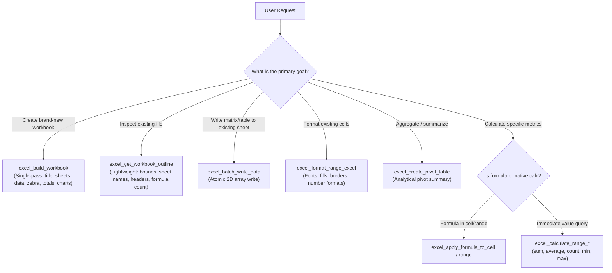

# Excel Tools Reference & Decision Matrix

This skill is the authoritative developer and agent guide for the **excel-mcp** server (`luiccian-excel-mcp`). It provides a tool selection decision tree, argument specifications, formatting tokens, and error handling protocols.

---

## 1. Tool Selection Decision Matrix

### Token Cost Comparison

| Operation | Legacy Granular Approach | Optimized Approach | Savings |
| :--- | :--- | :--- | :--- |
| **New 2-Sheet Financial Model** | `create_workbook` + 80 `write_data` + 30 `format_range` (111 calls, ~45,000 tokens) | `excel_build_workbook` (1 call, ~1,800 tokens) | **>95%** |
| **Workbook Inspection** | `read_data_from_excel` dumping 5,000 rows (~30,000 tokens) | `excel_get_workbook_outline` (1 call, ~250 tokens) | **>98%** |
| **Appending 20 Data Rows** | 20 individual `write_data` calls (~6,000 tokens) | `excel_batch_write_data` (1 call, ~600 tokens) | **>90%** |

---

## 2. Complete Tool Taxonomy

### A. Batch & Single-Pass Tools (Priority 1)

1. **`excel_build_workbook`**
   - **Purpose:** Construct complete, styled workbooks with multiple sheets in a single atomic pass.
   - **Arguments:**
     - `filename` (*str*, required): Absolute path within `MCP_ALLOWED_DIRECTORIES`.
     - `preset` (*str*, optional): `"corporate"` (default), `"financial"`, `"modern"`, `"compact"`.
     - `auto_fit` (*bool*, default `true`): Automatically fit column widths to contents.
     - `sheets` (*list[SheetSpec]*, required): Array of sheet specifications:
       - `name` (*str*, required): Worksheet title.
       - `title` (*str*, optional): Prominent header banner across row 1.
       - `headers` (*list[str]*, optional): Table column titles.
       - `rows` (*list[list[Any]]*, optional): 2D array of values and formula strings.
       - `currency_columns` (*list[str]*, optional): Header names to format with currency (`$#,##0.00`).
       - `auto_totals` (*list[int]*, optional): 0-indexed column indices to compute `=SUM()` automatically at bottom.
       - `chart` (*ChartSpec*, optional): Embedded chart configuration (`type`, `title`, `data_column`, `label_column`).

2. **`excel_get_workbook_outline`**
   - **Purpose:** Extract structure, dimensions, sheets, column headers, and formula presence without loading cell matrices into context.
   - **Arguments:** `filename` (*str*, required).

3. **`excel_batch_write_data`**
   - **Purpose:** Write a 2D matrix of values atomically into an existing worksheet.
   - **Arguments:**
     - `filename` (*str*, required)
     - `sheet_name` (*str*, required)
     - `data_matrix` (*list[list[Any]]*, required)
     - `start_cell` (*str*, default `"A1"`)

---

### B. Content Tools

4. **`excel_read_data_from_excel`**
   - **Purpose:** Read data from a specific range or preview a sheet.
   - **Arguments:** `filename`, `sheet_name`, `start_cell` (`"A1"`), `end_cell` (*optional*), `preview_only` (*bool*, default `false`).

5. **`excel_write_data_to_excel`**
   - **Purpose:** Write a single value or 2D array to a sheet (legacy single-cell / small write).
   - **Arguments:** `filename`, `sheet_name`, `data` (*Any*), `start_cell` (`"A1"`).

---

### C. Workbook & Sheet Management

6. **`excel_create_workbook`**: Initialize empty workbook with optional sheet name.
7. **`excel_create_sheet`**: Add a new worksheet tab (`filename`, `sheet_name`, `index`).
8. **`excel_copy_sheet`**: Duplicate an existing sheet (`filename`, `source_sheet`, `target_sheet`).
9. **`excel_delete_sheet`**: Remove a worksheet tab (`filename`, `sheet_name`).
10. **`excel_rename_sheet`**: Rename a worksheet tab (`filename`, `old_name`, `new_name`).
11. **`excel_get_workbook_info`**: Inspect file size, sheet count, sheet names, and active sheet.
12. **`excel_get_sheet_names`**: Retrieve array of worksheet names.

---

### D. Formatting & Layout Tools

13. **`excel_format_range_excel`**
    - **Purpose:** Apply styling to a cell span (`A1:D10`).
    - **Arguments:** `filename`, `sheet_name`, `start_cell`, `end_cell`, `font_name`, `font_size`, `font_bold`, `font_color`, `bg_color` (hex `#RRGGBB`), `alignment` (`"left"`, `"center"`, `"right"`), `border_style` (`"thin"`, `"double"`, `"thick"`), `number_format`.
14. **`excel_auto_fit_columns`**: Adjust column widths based on longest cell content.
15. **`excel_merge_cells`**: Merge cell span (`start_cell`, `end_cell`).
16. **`excel_unmerge_cells`**: Unmerge previously combined range.
17. **`excel_set_row_height`**: Set row height in points (`filename`, `sheet_name`, `row_index`, `height`).
18. **`excel_set_column_width`**: Set column width in characters (`filename`, `sheet_name`, `column_letter`, `width`).
19. **`excel_apply_conditional_formatting`**: Apply color rules or data bars (`rule_type`, `formula`, `min_color`, `max_color`).

---

### E. Calculation & Formula Tools

20. **`excel_apply_formula_to_cell`**: Write formula to single cell (`cell`, `formula` with `=`).
21. **`excel_apply_formula_to_range`**: Propagate formula across range with coordinate adjustments.
22. **`excel_validate_formula_syntax`**: Verify formula validity before inserting into sheets.
23. **`excel_calculate_range_sum`**: Return immediate sum of cell range.
24. **`excel_calculate_range_average`**: Return immediate average of range.
25. **`excel_calculate_range_count`**: Return count of non-empty cells in range.
26. **`excel_calculate_range_min`**: Return minimum value in range.
27. **`excel_calculate_range_max`**: Return maximum value in range.

---

### F. Graphics & Analytics Tools

28. **`excel_create_chart`**: Generate native charts (`bar`, `line`, `pie`, `scatter`, `area`, `donut`).
29. **`excel_create_pivot_table`**: Build analytical pivot summary (`rows`, `columns`, `values`, `aggfunc`).
30. **`excel_add_image_to_sheet`**: Embed image into sheet (`image_path`, `target_cell`).

---

## 3. Excel Format String Cheat-Sheet

| Format Type | String Code | Rendered Example | Usage |
| :--- | :--- | :--- | :--- |
| **Standard Currency** | `"$#,##0.00"` | `$1,250,500.50` | Revenue, expenses, P&L lines |
| **Accounting Standard** | `"$#,##0.00;($#,##0.00);\"-\"\""` | `($450.00)` | Negative numbers in parentheses |
| **Integer with Commas** | `"#,##0"` | `12,450` | Quantities, headcount, units |
| **Percentage (1 dec)** | `"0.0%"` | `14.2%` | Growth rates, margins, discount rates |
| **Percentage (2 dec)** | `"0.00%"` | `14.25%` | Precision yields, financial ratios |
| **ISO Date** | `"yyyy-mm-dd"` | `2026-11-09` | Timestamps, transaction dates |
| **Short Date** | `"mm/dd/yyyy"` | `11/09/2026` | US standard dates |

---

## 4. Formula Syntax Rules

1. **Prefix Obligation:** All formula strings must start with `=` (e.g. `"=SUM(B4:B12)"`, `"=C4-B4"`).
2. **Uppercase Functions:** Always use standard uppercase Excel functions:
   - Aggregations: `SUM`, `AVERAGE`, `COUNT`, `MIN`, `MAX`
   - Logic: `IF`, `AND`, `OR`, `IFS`
   - Lookup: `VLOOKUP`, `XLOOKUP`, `INDEX`, `MATCH`
   - Math: `ROUND`, `ABS`, `MOD`
3. **Relative Referencing in Matrices:** When building formulas in 2D rows for `excel_build_workbook`, reference the actual row index where the data lands (e.g., if header banner is row 1 and column headers are row 2, first data row is row 3: `"=C3-B3"`).

---

## 5. Common Errors & Recovery Protocols

| Error | Root Cause | Agent Recovery Action |
| :--- | :--- | :--- |
| `SheetNotFoundError` | Worksheet tab does not exist in workbook. | Call `excel_get_sheet_names` to verify exact sheet names before retrying. |
| `InvalidCellReferenceError` | Malformed coordinate like `A0` or `1A`. | Ensure cell references follow `[A-Z]+[1-9][0-9]*` pattern (e.g. `A1`, `B12`). |
| `FormulaSyntaxError` | Unbalanced parentheses or invalid syntax. | Run `excel_validate_formula_syntax` before inserting complex formulas. |
| `PathTraversalError` | Path outside `MCP_ALLOWED_DIRECTORIES`. | Use paths located strictly within designated allowed directories. |
| `SheetExistsError` | Creating a sheet name that already exists. | Use a unique name or call `excel_delete_sheet` first if replacing. |
